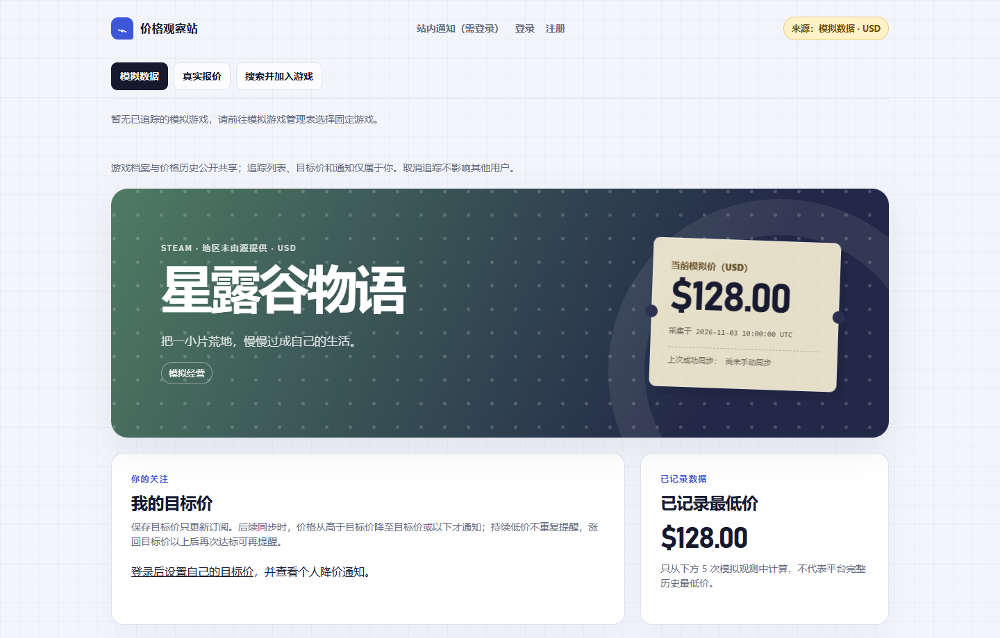

# 价格观察站（Steam / USD）

一个基于 Flask 的游戏价格追踪练习项目：用户管理自己的追踪列表和目标价，手动同步后在站内接收降价通知。游戏档案与价格历史共享，个人数据按用户隔离；内置离线模拟数据，可在不访问外部 API 的情况下演示完整流程。

## 核心功能

- 注册、登录、退出、普通用户和管理员角色；密码哈希、CSRF 和权限检查。
- 固定四款模拟游戏的个人追踪管理；真实游戏通过 CheapShark 搜索并加入。
- 当前价、已记录最低价、SVG 历史折线和完整可访问数据表。
- 每人独立的目标价与通知；单条/全部已读、导航未读数量。
- 手动模拟同步、动态 Steam/USD 同步、稳定快照去重和旧事件保护。
- 管理员网页控制台：固定操作、共享模拟调价、来源状态与审计记录。

## 实际页面



截图由本机 Edge 在独立临时数据库上渲染，使用模拟种子数据，不是实时报价。[更多图表截图与说明](docs/price-chart.md)。

## 技术栈与版本

| 层次 | 使用内容 |
|---|---|
| 后端 | Python、Flask、Werkzeug |
| 存储 | SQLite，金额为整数美分 |
| 页面 | Jinja HTML、现有 CSS、原生 SVG，少量原生 JavaScript |
| 真实来源 | CheapShark，仅 Steam / USD |
| 验证 | 标准库 unittest + HTTP mock；可选 Playwright 浏览器验收 |

最低 Python **3.10**；推荐本轮实际验证的 **Windows CPython 3.14.3（64 位）**。
`X | None` 类型注解与已固定 Click 8.4.1 的 Python ≥3.10 要求共同决定下限。
全部源码已做 3.10 语法检查；完整安装和测试实测于 3.14.3，未宣称所有中间版本均已实测。
运行时依赖及间接依赖精确固定在 [requirements.txt](requirements.txt)，没有额外 Python 运行库。

## 核心数据设计

| 数据 | 保存方式 |
|---|---|
| 游戏档案、外部 ID、价格历史 | 全站共享，模拟/真实为独立档案 |
| 个人追踪 | `user_game_tracking(user_id, game_id)`，联合主键 |
| 目标价、通知、已读状态 | 归属当前登录用户，所有权由服务端确定 |
| 价格事件 | 稳定 `source_event_id` 唯一；同一快照重放新增 0 条 |
| 通知 | 用户 + 游戏 + 事件唯一，保存当时目标价与触发价 |

同步先完成所有外部批次校验，再在 SQLite 事务中写入价格、通知和状态。
真实报价优先用来源时间排序；模拟事件保留采集时间规则。
价格从高于目标价降至目标价或以下才通知；持续低价不重复，首次真实采集只建立基线。
[事务、重试、迁移与隔离详解](docs/architecture.md)。

## Windows PowerShell 五分钟启动

先安装标准 CPython。下面第一条使用官方安装器常见的当前用户安装路径；若路径不同，仅将它替换为已确认的 CPython 绝对路径。不要使用恰好排在 PATH 前面的 MSYS2 Python。
在仓库根目录运行；已有可用 `.venv` 时跳过创建步骤：

```powershell
& "$env:LOCALAPPDATA\Programs\Python\Python314\python.exe" -m venv .venv
.\.venv\Scripts\python.exe -m pip install -r requirements.txt --index-url https://pypi.tuna.tsinghua.edu.cn/simple
.\.venv\Scripts\python.exe -m pip check
.\.venv\Scripts\python.exe -m flask --app app upgrade-db
.\.venv\Scripts\python.exe -m flask --app app run --debug
```

本轮在上述 HTTPS 镜像完成干净安装；网络可用时也可使用默认 PyPI，详见[安装与排错](docs/operations.md)。不需要激活虚拟环境或修改 PowerShell 执行策略。

- 游戏详情：[http://127.0.0.1:5000/games/1](http://127.0.0.1:5000/games/1)
- 模拟管理：[http://127.0.0.1:5000/games?source=demo](http://127.0.0.1:5000/games?source=demo)
- 注册：[http://127.0.0.1:5000/register](http://127.0.0.1:5000/register)
- 通知：[http://127.0.0.1:5000/notifications](http://127.0.0.1:5000/notifications)

`upgrade-db` 可重复执行，已有数据保留；没有美元库时才建立初始数据。
不要用会清库的 `init-db` 升级现有项目。旧人民币数据库始终保留，不换符号冒充美元。
模拟演示不需要密钥或网络；新注册用户从空追踪列表开始。

## 创建管理员

另开一个 PowerShell，在同一仓库目录执行：

```powershell
.\.venv\Scripts\python.exe -m flask --app app create-admin --username my_admin
```

密码在终端隐藏输入并确认，不写入命令历史。已存在的同名账号会被提升并重设密码。
登录后访问 [同步控制台](http://127.0.0.1:5000/admin/sync)；普通用户返回 403，匿名进入登录。
本地开发会复用忽略目录内的随机密钥；HTTPS 部署需设置 `APP_ENV=production` 和随机 `SECRET_KEY`，见[安全配置](docs/operations.md#secret_key-与-cookie)。

## 最短同步与通知演示

先注册登录，在模拟管理表追踪游戏 2，为它设置 `100.00` 美元目标价。
在终端建立本轮基线，再模拟降价；每次新演示更换事件前缀：

```powershell
$demoRun = Get-Date -Format 'yyyyMMddHHmmssfff'
.\.venv\Scripts\python.exe -m flask --app app sync-prices --game-id 2 --scenario price-128 --event-id "$demoRun-high"
.\.venv\Scripts\python.exe -m flask --app app sync-prices --game-id 2 --scenario price-90 --event-id "$demoRun-low"
```

刷新本人通知页可看到未读提醒，点击已读后导航数量减少。也可在管理员控制台选择游戏和场景操作。
同一游戏、价格和事件 ID 重放新增 0 条；同一 ID 换游戏或价格会失败。
`price-N` 的 N 是整数美元，范围 0～2147483647，内部乘 100 保存为整数美分。

可选的真实同步命令如下，需要网络且至少有一位用户追踪有效真实游戏：

```powershell
.\.venv\Scripts\python.exe -m flask --app app sync-prices --source cheapshark
```

没有真实追踪者时不请求 API。同一游戏被多人追踪只采集一次；最后一人取消才停止采集。
[多用户、跨阈值、事件重放完整验收](docs/testing.md)。

## 离线测试与交付检查

```powershell
.\.venv\Scripts\python.exe -m unittest discover -s tests -q
.\.venv\Scripts\python.exe -m compileall -q app.py admin_sync.py security.py migrations.py price_chart.py adapters services scripts tests
.\.venv\Scripts\python.exe scripts/check_docs.py
```

测试使用隔离数据库与 HTTP mock，不要求 CheapShark 在线；不会初始化你的日常数据库。
[最新验收结果](docs/delivery-check.md)记录干净环境的实际安装、测试数量和浏览器结果。

可选浏览器检查使用 [requirements-dev.txt](requirements-dev.txt) 中的 Playwright，调用已有 Edge/Chrome，不下载浏览器：

```powershell
.\.venv\Scripts\python.exe -m pip install -r requirements-dev.txt --index-url https://pypi.tuna.tsinghua.edu.cn/simple
.\.venv\Scripts\python.exe scripts/browser_smoke.py
```

[截图脚本](scripts/capture_price_chart.py)只需本机 Edge/Chrome 和运行时依赖，不需要 Playwright。
[全新临时环境验证脚本](scripts/verify_delivery.py)会另建项目副本和虚拟环境，详见[运维文档](docs/operations.md)。

## 已知限制

- CheapShark 是缓存报价，可能与 Steam 当前结账价不同；跨商店最低价只是搜索页次要参考。
- 仅 Steam / USD；接口未给出明确地区，不能据美元推断“美国区”，不做汇率换算。
- 缺少价格不等于免费；明确 `0.00` 只说明本次报价为零，不代表永久免费。
- 真实历史从首次成功采集起算，“已记录最低价”不代表平台完整历史最低价。
- 无法恢复未采集到的中间变价；来源版本不变时不会凭重复同步制造新价格事件。
- 429、TLS、代理或响应错误时保留旧价格和上次成功时间，没有后台定时采集。
- 账号系统面向学习演示；没有邮箱验证、找回密码、登录限流或 MFA，不能直接当作完整生产身份系统。

[官方要求、真实探测记录和无法验证项](docs/cheapshark.md)。

## 项目目录与代码入口

```text
app.py                    路由、Flask CLI、初始化与页面查询
security.py               当前用户、登录/管理员装饰器、CSRF、Cookie、跳转
admin_sync.py             固定管理员同步动作与审计
price_chart.py            只读价格历史 SVG 坐标
adapters/                 模拟及 CheapShark 数据适配、事件契约
services/                 账号、追踪、价格事务、共享输入校验
migrations.py             可重复执行的数据库升级
*.sql                     表、索引及唯一约束
templates/                Jinja 页面和公共片段
static/                   CSS、密码显示脚本、本地 favicon
scripts/                  探测、只读数据库检查、截图与交付验证
tests/                    离线业务、安全、迁移与展示测试
docs/                     设计、操作、验收记录与截图
```

| 关键入口 | 作用 |
|---|---|
| [services/accounts.py](services/accounts.py) | 用户名与密码规则、Werkzeug 哈希 |
| [security.py](security.py) | 身份加载、权限和 CSRF |
| [services/game_tracking.py](services/game_tracking.py) | 外部 ID 去重、个人追踪关联 |
| [services/price_sync.py](services/price_sync.py) | 事务、来源时间、幂等、通知与重试 |
| [services/sync_inputs.py](services/sync_inputs.py) | 网页和 CLI 共用的模拟校验 |
| [admin_sync.py](admin_sync.py) | 管理员控制台操作 |
| [price_chart.py](price_chart.py) | 图表坐标；[图表模板](templates/_price_history_chart.html) |

## 详细文档

- [架构与业务约束](docs/architecture.md)：共享数据、用户隔离、幂等、事务、通知与旧数据迁移。
- [运维与环境排错](docs/operations.md)：安装、升级、管理员、密钥、代理/TLS 与安全重建虚拟环境。
- [测试与手动验收](docs/testing.md)：两个用户会话、管理员演示、通知已读和数据库核查。
- [CheapShark 说明](docs/cheapshark.md)：搜索、加入、Steam/USD 限定与历史验证记录。
- [价格图表与截图](docs/price-chart.md)：空历史、单点、长历史、金额范围与截图复现。
- [章节迁移清单](docs/documentation-map.md)：原 README 的 35 个章节去向。

本轮只整理文档、固定依赖、增加交付检查和本地图标；账号、追踪、同步、通知、价格及管理员规则不变。
