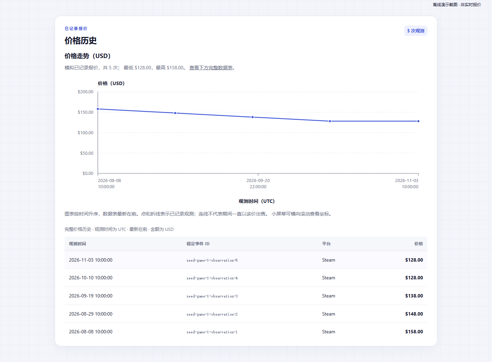
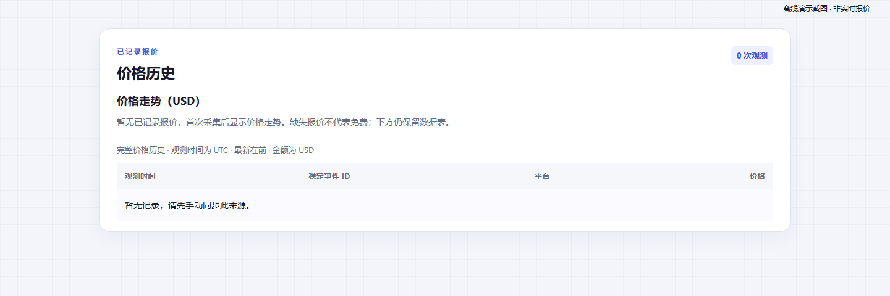
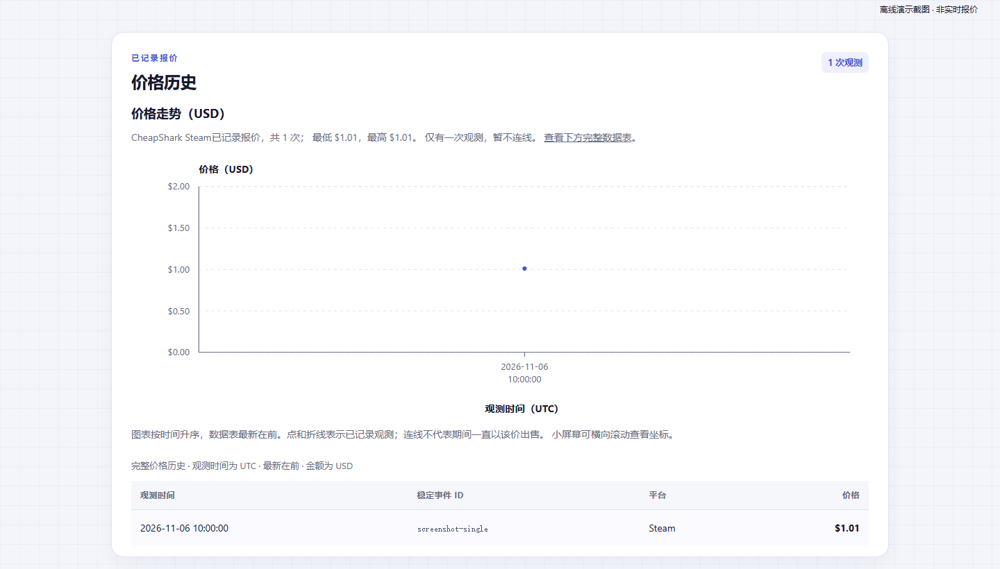

# 价格历史图表与截图

[项目首页](../README.md) · [架构](architecture.md) · [运维](operations.md) · [测试](testing.md) · [数据源](cheapshark.md) · [图表](price-chart.md)

本文保留并按主题整理原 README 的设计说明、操作示例和验收记录。沿用的“本轮/新增”等措辞属于相应功能阶段；当前交付范围以 [验证记录](delivery-check.md) 为准。所有命令从仓库根目录执行，联网命令仅供可选人工操作；本次整理未请求真实 CheapShark API。

## 详情页价格历史折线图

详情页“价格历史”区域新增原生 SVG 图表，无 JavaScript、JSON 注入、CDN 或新增依赖。横轴为观测时间（UTC），按实际时间间隔从早到晚排列；纵轴为 USD，从零起算，自动选择刻度。下方保留完整可横向滚动、可通过键盘聚焦的表格，继续按最新记录在前显示。图表有标题、文字描述、观测圆点及最低/最高价摘要，不只依赖颜色传达信息；鼠标停在圆点上也可查看时间和金额。

- 空历史显示“暂无已记录报价”，不绘制虚假的零价；一条记录只显示一个点，不连线。
- 相同价格显示水平线；同一时刻的记录按数据库 ID 稳定排序，重合点仍可在表格区分。零价和 SQLite 整数范围内的极大金额都能生成有限坐标，金额始终保持整数美分、显示两位小数。
- 长历史用一条 `polyline` 保留全部观测点，超过 80 条时仅显示首尾圆点，减少 SVG 节点；表格保留全部记录。已用 5,000 条离线历史验证。超长表格目前没有分页，记录特别多时仍有页面体积和渲染开销。
- 线段只连接已记录报价，不表示两次采集之间一直使用该售价，也不补齐首次真实采集前的历史；“已记录最低价”规则不变。窄屏可分别横向滚动图表和数据表。

代码入口：`app.py` 沿用原详情页查询，将历史交给只读展示函数 `price_chart.py`；`templates/_price_history_chart.html` 通过 Jinja 自动转义输出数值坐标、文字与 SVG，未使用 `safe` 输出拼接 HTML，也未把 JSON 写入脚本。同步、账号、通知和数据库结构没有修改，本轮无需升级或清库。

截图来自实际详情模板的价格历史区域，使用独立临时数据库和本机 Edge 无界面渲染；均为离线演示，不能当作 CheapShark 当前报价：



上图使用原星露谷物语的五条模拟种子记录，可在 `/games/1#price-history` 查看同一区域；现有数据库已有更多观测时，图形会随记录变化。



上图展示未采集真实档案的空状态；“缺失”与“免费”分开处理。



单点截图的 `$1.01` 是临时数据库中的离线测试值，仅演示真实来源档案的布局，不代表接口实时报价。

如需重新生成这三张截图，请使用已安装 Flask 的 Python，电脑需已有 Edge 或 Chrome：

```powershell
.\.venv\Scripts\python.exe scripts/capture_price_chart.py
# 自动检测失败时指定浏览器路径：
.\.venv\Scripts\python.exe scripts/capture_price_chart.py --browser 'C:\Program Files (x86)\Microsoft\Edge\Application\msedge.exe'
```

脚本只在新建临时目录中初始化演示数据库，截图输出到 `docs/screenshots`，不会对现有美元库或旧人民币库执行 `init-db`，也不请求外部 API。针对图表的离线测试可运行 `.\.venv\Scripts\python.exe -m unittest tests.test_price_chart -v`，全套为 `.\.venv\Scripts\python.exe -m unittest discover -s tests -q`。
